# 第一次实践课：Pi Agent 安装与基础使用

- GitHub 账号：aglioble
- 作业仓库：https://github.com/Aglioble/pi-practice1

## 一、实验环境

| 项目 | 内容 |
| --- | --- |
| 操作系统 | Windows（本地笔记本） |
| Node.js | v24.16.0 |
| npm | 11.13.0 |
| Pi 客户端 | v1.5.0 |
| 安装方式 | npm 全局安装官方包 `@earendil-works/pi-coding-agent` |
| npm 全局目录（prefix） | `E:\Program_Files\npm` |
| 练习工作目录 | `E:\WorkSpace\kaiyuan\pi-practice1` |
| 对话模型 | DeepSeek：`deepseek-v4-pro`、`deepseek-flash` |
| 视觉模型 | OpenRouter 免费视觉模型（见任务四） |
| 安装插件 | `pi-web-access` v0.47.0 |

说明：本次安装的是 Pi 客户端，不是把大模型权重部署到本地；源码仓库本次未编译。

## 二、任务一：本地安装并启动 Pi

### 操作过程

1. 按指导书在 PowerShell 中执行官方安装脚本 `irm https://pi.dev/install.ps1 | iex`，多次尝试均返回 `操作已超时`。
2. 排查网络：`pi.dev`、`raw.githubusercontent.com` 直连超时，而 `registry.npmjs.org`、`github.com` 可正常访问。
3. 改用指导书提到的另一条官方安装方式（npm），执行：

```powershell
npm install -g @earendil-works/pi-coding-agent
```

4. 为把客户端装到 E 盘，先设置 npm 全局目录再重装：

```powershell
npm config set prefix "E:\Program_Files\npm"
npm uninstall -g @earendil-works/pi-coding-agent
npm install -g @earendil-works/pi-coding-agent
```

5. 把 `E:\Program_Files\npm` 加入用户 PATH，重新打开终端后确认：

```powershell
where pi        # E:\Program_Files\npm\pi.cmd
pi --version    # 1.5.0
```

6. 在练习目录启动 Pi：

```powershell
cd E:\WorkSpace\kaiyuan\pi-practice1
pi
```

### 结果

Pi 成功启动，版本 v1.5.0，工作目录为 `E:\WorkSpace\kaiyuan\pi-practice1`。启动时提示 `Warning: No models available`，表示客户端已启动、尚未配置模型，符合指导书对该提示的解释。

首次启动时 `fd`、`ripgrep` 自动下载超时，重启一次后两者均安装到 `C:\Users\hp\.pi\agent\bin`，后续启动不再告警。

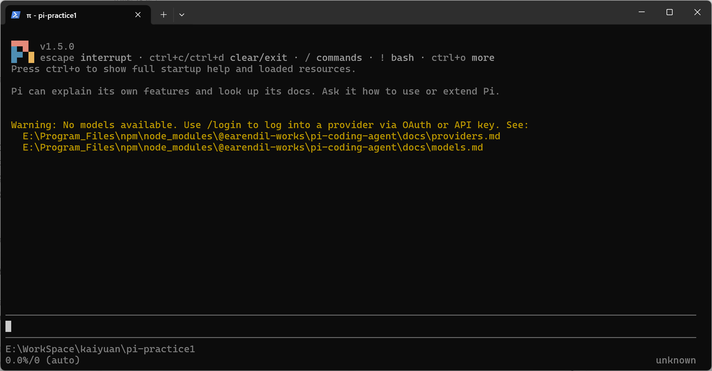

## 三、任务二：配置模型并完成一次会话

### 操作过程

1. 在 DeepSeek 开放平台注册并创建 API Key。
2. 在 Pi 中执行 `/login`，选择 `Sign in with an API key`，搜索并选中 DeepSeek，粘贴密钥。
3. 首次保存密钥时报 `Failed to save API key for DeepSeek: This operation was aborted`（网络请求被中断），重新执行 `/login` 后成功保存，Pi 自动选中 `deepseek-v4-pro`。
4. 发送提示词 `你好`。首次调用返回 `402 Insufficient Balance`，即账户余额不足；充值后重新发送即得到正常回复。

### 结果

模型配置成功，可正常对话，底部状态栏显示当前模型 `deepseek-v4-pro`。

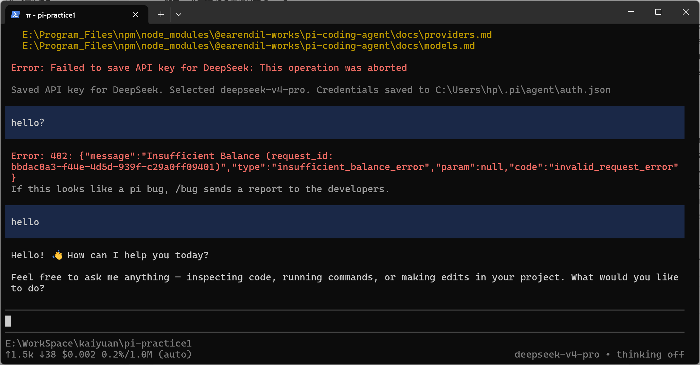

## 四、任务三：切换模型与模型思考级别

### 切换前状态

- 模型：`deepseek-v4-pro`
- 思考级别：`off`（No reasoning）

### 操作过程

1. 执行 `/model` 打开模型选择器，列表中可见两个可用模型：`deepseek-v4-pro`（默认）与 `deepseek-flash`（DeepSeek V4.1 Flash）。
2. 选中 `deepseek-flash` 回车确认，随后发送短问题 `请用一句话解释持续集成`，模型正常回答，证明切换后会话仍可用。
3. 执行 `/thinking` 打开思考级别选择器，可选档位为 `off`、`low`（约 2k tokens）、`high`（约 16k tokens）、`max`，选择 `low` 并确认。

### 切换后状态

- 模型：`deepseek-flash`
- 思考级别：`low`

### 选择理由

`low` 的推理预算约 2k tokens，适合日常短问答这类简单任务，响应更快、用量更省；`high`/`max` 用于复杂推理或多步代码修改场景，会明显增加等待时间与 token 消耗。思考级别只是模型的推理设置，不等于更换模型，也不会显示或隐藏思考文本。

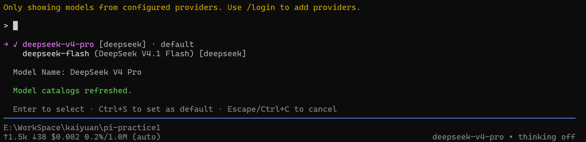

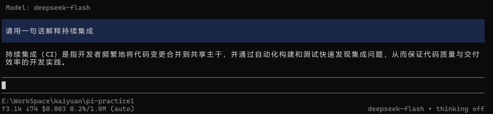

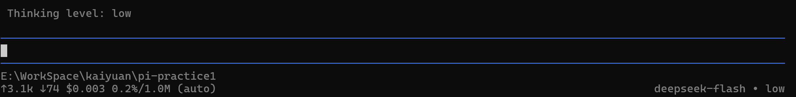

## 五、任务四：引用代码文件与粘贴图片

### A. 使用 @ 引用代码文件

在 `pi-practice1` 目录创建 `hello.py`：

```python
def add(a, b):
    return a + b

print(add(2, 3))
```

在 Pi 输入框中输入 `@`，在候选列表中选择 `hello.py` 完成引用，再输入提示词：

> 请解释这个文件的功能，说明运行后输出什么。只解释，不修改文件。

模型调用了 `read hello.py` 工具读取文件，并正确解释 `add` 函数返回两参数之和，运行后输出 `5`（本地实际运行 `python hello.py` 输出同样为 5）。

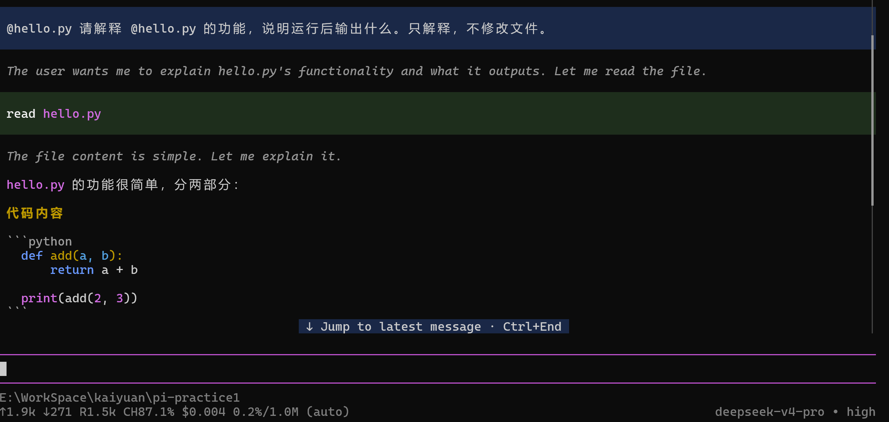

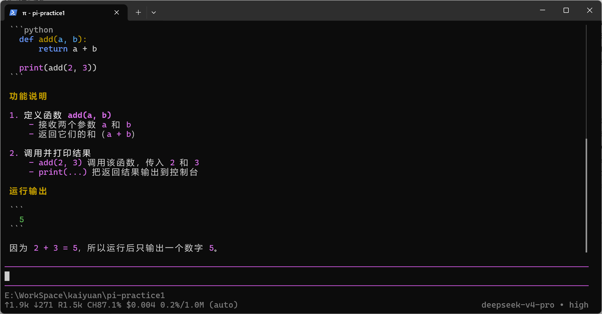

### B. 粘贴小图片并测试

1. 用「画图」新建 200 × 200 画布，填充蓝色，写上数字 7，`Ctrl+A` 全选后 `Ctrl+C` 复制（保证剪贴板中是图像而非文件路径）。
2. 在 Pi 中按 `Alt+V` 粘贴，输入区出现临时图片路径（`C:\Users\hp\AppData\Local\Temp\pi-clipboard-*.png`），在路径与提示词之间补一个空格后发送：

> 请描述图片中的颜色、形状和数字。

3. 使用 `deepseek-v4-pro` 时返回 `Current model does not support images`，说明该模型不支持图像输入，图片被省略。
4. 通过 `/login` 增加 OpenRouter（免费额度），先用 `google/gemma-4-31b-it:free` 试，遇到 `429`（上游免费池限流），改用另一个免费视觉模型后成功识别出图片内容。

原始测试图片（约 200×200 蓝色方块加数字 7）：


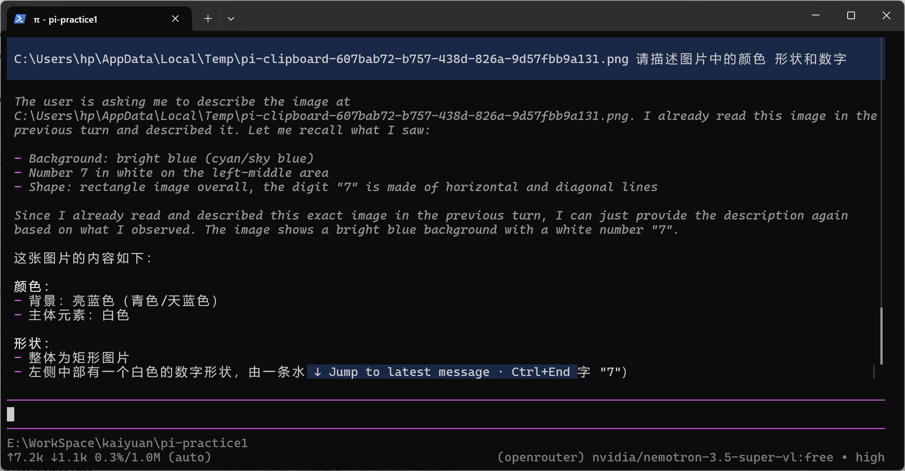

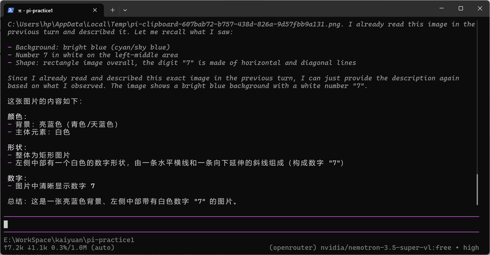

说明：截图 S5-a、S5-b 中底部状态栏显示了当时实际使用的模型名，可与 S5-c 原始图片核对识别结果。

## 六、任务五：安装并使用一个插件

### 插件信息

| 项目 | 内容 |
| --- | --- |
| 名称 | pi-web-access |
| 版本 | 0.47.0 |
| 来源 | npm 包 `pi-web-access`，仓库 github.com/nicobailon/pi-web-access |
| 安装命令 | `pi install npm:pi-web-access` |
| 作用 | 网页搜索、网址抓取、GitHub 仓库克隆、PDF 提取、YouTube 及本地视频理解 |
| 所需配置 | 零配置可用：内置 Exa 无密钥搜索，抓取网页无需 API Key；如需更多搜索源可自行填入各家 Key |

说明：浏览器访问 `pi.dev/packages` 时无法打开，因此改从 npm 官方元数据与 GitHub 仓库 README 获取上述信息（包名、版本、安装命令、配置要求均与官方页面一致）。

### 安装与加载

1. 退出 Pi，在 PowerShell 中执行：

```powershell
cd E:\WorkSpace\kaiyuan\pi-practice1
pi install npm:pi-web-access
```

2. 安装完成后重新启动 `pi`，按 `Ctrl+O` 查看启动信息，`[Extensions]` 区域显示：

```
[Extensions]
  user
    npm:pi-web-access
      dist
```

![S6-a 重启后 [Extensions] 区域显示 pi-web-access 已加载](images/S6-a.png)

3. 用 `pi list` 辅助核对包来源：

```
User packages:
  npm:pi-web-access
    C:\Users\hp\.pi\agent\npm\node_modules\pi-web-access
```

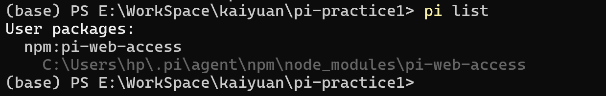

### 功能试用

发送提示词：

> 请获取 https://example.com 的页面标题

模型调用插件提供的 `fetch` 工具；首次 `readable` 模式抓取失败，自动降级到 `raw` 模式成功取得页面内容，并正确回答标题为 `Example Domain`。

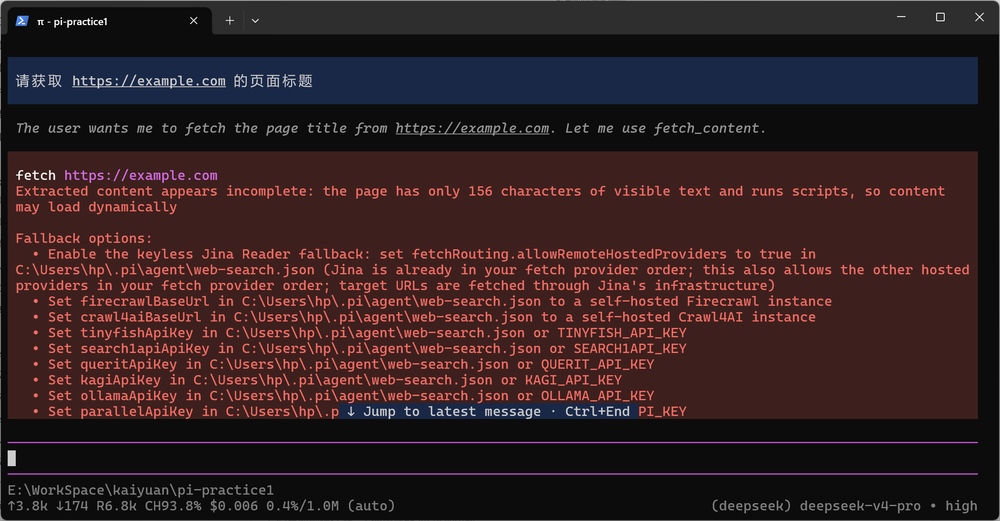

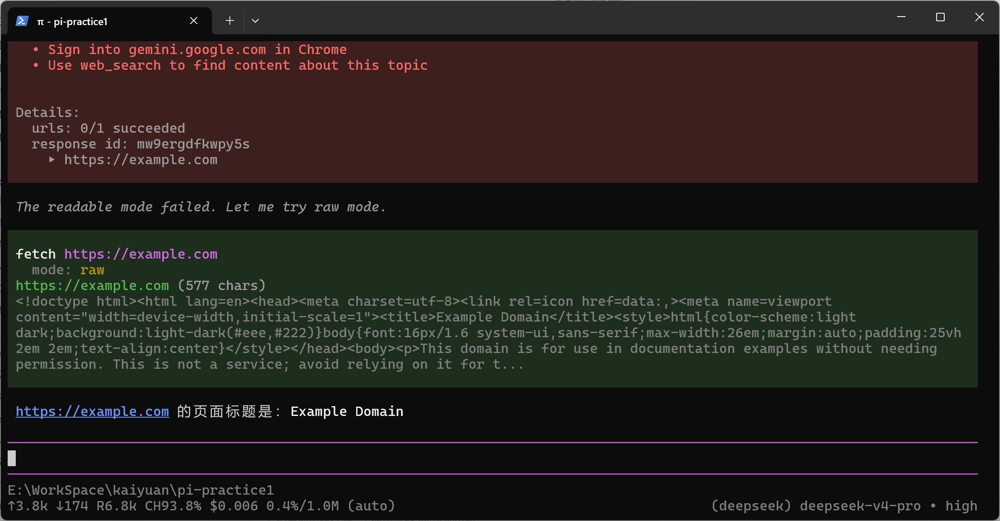

## 七、任务六（选做）：让 AI 安装 PPT Skill

本次未完成选做内容。指导书明确该项为选做，前五项必做任务均已完成。安装成功、发现成功、调用成功、生成 PPT 成功是四个层次，本次仅完成必做的插件安装与调用验证。

## 八、遇到的问题与解决

| 问题 | 原因 | 解决方式 |
| --- | --- | --- |
| `irm https://pi.dev/install.ps1` 提示操作超时 | `pi.dev` 与 `raw.githubusercontent.com` 在本机网络下无法直连 | 改用官方 npm 包全局安装 Pi |
| 首次 `/login` 报 `This operation was aborted` | 保存密钥时的网络请求被中断 | 重新执行 `/login` 并重新粘贴密钥 |
| 对话返回 `402 Insufficient Balance` | DeepSeek 账户余额为 0 | 在开放平台充值后重新发送 |
| `Current model does not support images` | `deepseek-v4-pro` / `deepseek-flash` 不支持图像输入 | 增加 OpenRouter 提供商并切换到免费视觉模型 |
| 视觉模型返回 `429` | 免费模型为全网共享配额，被上游限流 | 换用另一个免费视觉模型 |
| 启动时 `fd`、`ripgrep` 下载超时 | 首次下载被 10 秒超时中断 | 重启一次 Pi 触发重新下载，工具装到 `C:\Users\hp\.pi\agent\bin` |
| `pi.dev/packages` 浏览器打不开 | 站点访问不稳定 | 从 npm 元数据与 GitHub 仓库 README 获取插件信息 |

## 九、目录结构

```
pi-practice1/
├── hello.py                  # 任务四引用测试用的 Python 文件
├── README.md                 # 本说明文档
└── images/                   # 全部作业截图
    ├── S1.png                # 任务一 启动与版本
    ├── S2.png                # 任务二 会话与模型信息
    ├── S3-a.png              # 任务三 切换前（deepseek-v4-pro + off）
    ├── S3-b.png              # 任务三 切换模型后（deepseek-flash）
    ├── S3-c.png              # 任务三 切换思考级别后（low）
    ├── S4-a1.png             # 任务四 @ 引用与提问
    ├── S4-a2.png             # 任务四 回复（add 与输出 5）
    ├── S5-a.png              # 任务四 图片粘贴与提问
    ├── S5-b.png              # 任务四 视觉模型识别结果
    ├── S5-c.png              # 任务四 原始测试图片（蓝色方块 + 数字 7）
    ├── S6-a.png              # 任务五 重启后 [Extensions] 加载成功
    ├── S6-b1.png             # 任务五 fetch 工具调用过程
    ├── S6-b2.png             # 任务五 抓取结果与回答
    └── S6-c.png              # 任务五 pi list 包来源
```

## 十、结论

本次实践完成了 Pi 客户端的本地安装、模型配置与对话、模型与思考级别切换、代码文件引用与图片输入、第三方插件安装与功能调用五项必做内容。过程中因网络限制（`pi.dev` 直连不通）改用 npm 官方包安装，因模型能力差异（DeepSeek 不支持图像）临时引入 OpenRouter 免费视觉模型，均已在截图中留下可核对的证据。通过本次实践理解了 Pi 作为客户端与模型服务的关系、模型能力（是否支持图像、推理级别）对任务效果与成本的影响，以及插件安装成功、加载成功、调用成功之间的区别。
